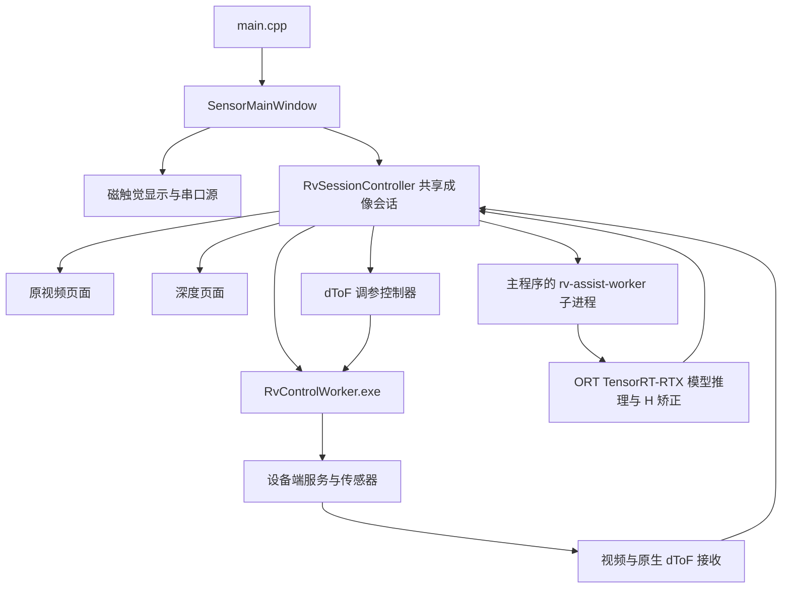

# 项目架构

本项目是独立的 Windows x64 传感器上位机，主窗口提供磁触觉、深度图和摄像头原视频。dToF 运行预设由成像方案选择。本文描述当前日常版本的架构。已验证的加密实验与未来安装包约定见 [模型保护](MODEL_PROTECTION.md)，维护约束见根目录 本地 AGENTS.md。

## 产品边界

主窗口提供三个模块，以及设备管理、成像选择、渲染、语言、停靠和布局预设菜单。深度产品入口固定如下：

| 显示名称 | 产品入口 ID | 推理和处理位置 |
|---|---|---|
| 上位机辅助推理 | `host_unidepth_wide_576_fp16_tof16` | 主机 RGB576 FP16 神经网络＋16×16 原生 dToF，固定 H 矫正 |
| 上位机辅助推理（640×480） | `host_unidepth_rgb672_vga_fp16_tof16` | 工作区 TensorRT-RTX，RGB672×504 FP16，中心裁出 640×480 后做 H 矫正 |
| 板端推理 | `board_litesr_near_full_host_contour_hd` | 设备端近距完整 LiteSR INT8 模型＋主机轮廓处理＋H.265 高清视频 |
| 板端推理（384×256） | `board_litesr_near_384x256_host_contour_hd` | 独立 mode16 矩形 LiteSR INT8 包；48×32 D/I → 96×64 → 384×256，主机矩形轮廓和原 H.265 |
| 板端推理（128×128，相机关闭） | `board_litesr_near_128x128_depth_only` | 独立 mode17；16×16 同帧 D/I → 32×32 → 128×128，RV1103 完成推理、重建和掩码；相机关闭 |

主机 worker 使用 `unidepth_wide_576_fp16_tof16` 和 `unidepth_rgb672_vga_fp16_tof16` 两个模型 ID，与上表的成像方案 ID 区分。产品声明见 `DCTS_APP.json`，入口过滤还由 `DepthMapWidget`、`RvSessionController`、`RvAssistDepth` 和 `RuntimeDiscovery` 实现。共享算法中保留的其他模型兼容分支不代表产品入口可用，不据此恢复入口或复制模型包。

移植来源 `E:/WORK/Dexterous Hand Visualization` 只读。当前工程的源码、模型包、RV worker、资源和配置均独立；日常运行不依赖该来源项目目录。

## 模块与进程



`SensorMainWindow` 创建一个共享 `RvSessionController`，深度页面、原视频页面和 dToF 调参模块围绕同一个设备会话工作。不能为每个页面各自启动一套采集服务。板端 LiteSR 使用设备管理安装的密文模型与匹配的 F1/F2 原生程序，从内存初始化 RKNN。运行程序接收现有 TMF9 v4 和 SPI v5 数据，保留标定和同帧 Signal 校验。

| 入口或文件 | 职责 |
|---|---|
| `main.cpp` | 应用初始化、独立配置、离线测试分发、主机推理 worker 分发 |
| `SensorMainWindow.*` | 三个模块与菜单、布局恢复、异步停止和退出等待 |
| `TactileDockWidget.*`、`sensors/TactileVisualizationWidget.*` | 磁触觉操作、曲线、三维显示与串口连接 |
| `sensors/TactileSerialSource.*` | 串口测量、设备型号识别及有界自动置零 |
| `sensors/TactileSceneAdapter.*`、`TactileSurfaceModel.*`、`qml/` | 三维场景数据与表面资源 |
| `sensors/RvSessionController.*` | 设备身份、成像状态机、配对、结果时效、共享采集和停止 |
| `sensors/RvHdVideoStream.h`、`RvCameraStream.h`、`RvDtofBoardStream.*` | 高清视频、RGB 处理及原生 dToF 接收 |
| `sensors/RvAssistDepth.*` | 原生模型会话、worker IPC、模型输入方向、预测逆恢复和融合调用 |
| `sensors/RvAssistFusion.*`、`RvDepthDiagnostic.*`、`RvDepthCoverage.*` | 米制融合、尺度连续性、校正点和同帧诊断 |
| `sensors/RvDepthView.*`、`DepthMapWidget.*`、`RtspCameraPage.*` | 深度与视频显示、悬停数值、显示设置和快照 |
| `sensors/RvLiteSrContour.*` | 板端 LiteSR 对应的主机轮廓处理 |
| `sensors/RvDeviceStore.*`、`RvDeviceManagerDialog.*` | 受信任设备档案、标定选择和输入方向 |
| `sensors/RvUsbEnrollment.*` | USB ADB 发现、用户确认、板端与 RNDIS 网卡配网、受信任档案登记 |
| `sensors/RvTunerController.*`、`RvTunerWidget.*`、`RvTunerProtocol.*` | 独占调参、异步操作、停止、长期参数保存 |
| `RvControlWorker.cpp`、`RvControlProtocol.*` | 原生 libssh2/OpenSSL 控制、身份校验与板端服务操作 |
| `RuntimeDiscovery.*` | 应用根目录、运行时覆盖路径、worker 清单和依赖校验 |

主机模型 worker 由同一主程序 EXE 的 `--rv-assist-worker` 模式启动，使用 `QCoreApplication` 和二进制 IPC，不是 Python 进程。`RuntimeDiscovery::PythonResult` 是保留的类型名，当前设备控制实际返回原生 `RvControlWorker.exe`，也没有 Python 回退。

普通启动由 `main.cpp` 显式请求一次磁触觉默认串口连接，待模块可见和 QML 就绪后执行。控件构造、显示、离线专项及实机深度专项均不会自行打开磁触觉串口。默认参数优先恢复 `tactile/serial` 中上次经有效回包确认的端口、波特率、地址和模块。已保存端口缺失时保持待连接。自动、手动和重连均先以 0x03 读取 0x44C0，严格校验地址、功能码、长度、CRC 和型号值 1/2/3。优先使用当前地址，失败后在当前波特率尝试公共地址 0。公共地址恢复适用于单设备总线，需读出 0x466C 的实际地址并用该地址复读同一型号。未知型号或识别失败显示错误状态，不改变设置面板的显隐。界面按同次 session/generation 的已确认型号同步更新选中模块、硬件类型和实际地址，首帧使用实际型号的 20/16 点布局。手动修改通信参数后连接也走相同流程。

首份 CRC 正确、量程有效且身份匹配的数据到达后，停止连接响应计时并进入有界的自动 delta 置零。`TactileAutoZero` 在串口线程逐帧处理原生测量，先舍弃 150 ms 的稳定等待段，再检查最近 300 ms 的有效帧：至少 6 帧、跨度至少 200 ms、相邻有效帧间隙不超过 120 ms，每点每轴极差不超过 150 counts，前后半段均值差不超过 40 counts。最早 500 ms 完成稳定均值置零；900 ms 到期仍未形成稳定均值时，以本次连接最新一份 CRC 正确、量程有效且身份匹配的原生帧自动置零一次。兜底与正常均值置零使用同一个完成流程，不显示未完成或要求手动置零的提示。计时从首份有效测量开始；尚无有效测量、断开或显式取消不会生成零点。均值按原始单 count 精度取整并重算合力，只用作显示基线，不进入原始帧或采集历史。完成结果随最新帧持续携带，GUI 合并采样不会丢失零点。等待期间隐藏力箭头和曲线，完成状态独立于通信诊断开关显示；均值置零和到期单帧置零均不改变设置面板的显隐，手动置零按钮继续可用。默认约 1.5 秒未收到首份有效数据则异步停止，较长通信超时会相应增加连接等待时间。每个连接会话只进行一次有界自动置零，完成后不跟随受力更新基线。运行中结合 Windows 串口到达与移除通知及端口列表轮询，检测到记住的端口新出现时，按当前界面上的波特率和从站 ID 尝试连接。没有记住的端口时，仅在单个串口新出现时尝试。热插拔快速探测窗口至少为 10 秒。失败后保留当前设置面板显隐，端口仍存在且被选中时，等待 3 秒后再执行一轮型号识别，当前地址和公共地址各尝试一次。识别成功且首帧有效后继续使用同一个串口采集，失败则在等待期间释放串口。端口缺失时只监测插拔。用户主动断开后，同一次插接保持停止。

“连接设置”每次启动默认展开，“显示设置”默认收起，之后只由用户手动显隐。两个面板不随连接、置零、故障、断开、重试或模块启停自动展开或收起；不保存展开状态，也不读取旧的 `tactile/display/expanded` 偏好。其余显示参数继续持久保存。

磁触觉请求后间隔默认及下限均为 10 ms，可在采集中修改。串口线程在一笔请求完整结束后用 Windows 高精度等待定时器计时，停止、配置操作和间隔编辑可唤醒等待；系统无法创建该定时器时退回有界睡眠。自动置零期间临时使用 10 ms 请求后间隔，成功、失败或取消后恢复当前用户请求间隔，界面数值和持久偏好不被临时采样覆盖。置零开始后单次响应等待受剩余 900 ms 窗口约束，避免较长通信超时拖住本次尝试。单次请求的传输和响应耗时另计，GUI 仍按独立的 33 ms 定时器读取最新数据。轻微读数抑制默认开启，用户保存的显示偏好继续生效；原始数组和串口协议不受显示置零或抑制影响。

磁触觉“显示方式”保留 gridSize 2/3/4 档，名称按当前模块的实际点数生成：F/G 为 20/65/136，S 为 16/49/100。首次启动选择最高点数档和流畅渲染，后续恢复用户选择。`TactileSurfaceModel` 的采样函数复用既有空间插值权重；列表对当前帧、零点基线采样，曲线对原始历史逐帧采样，不向 `Frame` 或 `TactileHistory` 填入伪造的原生测点。列表和曲线分别在 100 ms 和 66 ms 内合并刷新请求，三维发布和历史采样沿用原有节奏。点选、置零和密度切换即时刷新相关视图。选择超出较低密度范围时收敛到有效行。

列表仅输出从原始基线计算的 delta，轴表头为 X、Y、Z；基线或数据无效时显示“--”，不回退显示当前读数。共享 `zeroSmallComponents` 仅对 X、Y 应用原有的包容边界阈值，Z 原样通过；模型、曲线、列表及插值点均采用此策略。三维模型保持原有的基线相减及插值顺序。过滤仅影响显示，不改原始帧、串口诊断、跳变准入或历史样本。

通信状态每次启动时关闭，隐藏的状态行不占用空间。开启后，串口栏显示端口、ID、接收计数和通信错误，列表下方只在有可显示的过滤错误时出现提示。QML 测点详情显示点号与数值。模拟数据源、模拟场景和底部恢复模拟/场景下拉/暂停按钮均已删除，硬件断开使用连接设置中的异步停止入口。窗口启停与可见性只控制显示刷新和串口挂起，不产生读数。无设备、断开、错误型号页面或数据失效时保留模型并显示“设备未连接/数据不可用”；其他型号不会补充模拟帧。固定原生格式样本仅存在于测试目录，用于离线渲染回归，不提供产品入口。

## 主机 H 数据链路

上位机辅助推理固定使用 H。输入方向在「设置 → 设备管理 → 上位机推理输入朝向」调整。已有设备沿用旧版深度图按设备及安装角度保存的方向，设备管理显示该生效值。保存设备时，当前选中的方向写入设备档案，并移除对应的旧偏好。

1. 原视频和原生 dToF 数据进入共享会话，携带设备身份、generation、frame、原生序号和时间戳等元数据。
2. RGB 使用对应标定图处理到模型输入网格。模型输入为 `[1,3,324,576]`、`uint8`，网络内部配置为 RGB576 加边框；输出为 `[1,1,324,576]`、`float32` camera-Z 米制深度。
3. 根据设备档案中的实际模型输入方向，按 0°或 180°处理输入；180°输入按每个平面通道反转。
4. ORT 1.31.1 TensorRT-RTX EP 执行模型，预测结果先逆恢复到原标定网格，再使用原始 dToF 网格做 H 矫正。显示旋转独立，不能根据 GUI 是否正立判断模型输入是否正确。
5. worker 返回米制深度、同帧元数据及 `mono_reasons_v1` 诊断；会话检查身份、方向和时效后交给显示层。

H 可以在 100 ms 内复用最新有效原生测量，但必须标明 `tof_reused` 和配对差值。历史尺度帧不得携带旧校正点冒充当前原生支持。原生控制 worker 在现有板端协调器启动候选采集时传递会话预设。H 使用 16×16 普通、单目标、Signal 和 Noise 关闭，并继续校验 Native16 能力和实际输出网格。LiteSR 使用 48×32 普通、单目标、Signal 开启、Noise 关闭。两模式沿用原有停止和故障处理，预设不写入长期传感器参数。

640×480 档从 2304×1296 解码帧直接校正取样 672×504，模型内裁去左右各 16、上下各 12 像素。输入射线中心位于 672×504 网格，输出中心位于 640×480 网格。有效区沿用 RGB576 的垂直视角，4:3 网格的水平视角收窄。模型和映射各自绑定 SHA-256。

`RvAssistFusion::ScaleContinuity::apply` 使用实际单调时间计算平滑，因此不同运行节奏下连续 H 最终深度可能不同。固定身份、方向与状态的合成场景用于逐字节一致性检查；长流性能实验同时检查稳定的神经网络预测张量，不能要求不同墙钟节奏下的全部平滑深度字节恒等。

## Native16 板端推理与状态准入

mode17 使用 16×16 普通、33 ms、单目标、Signal 开／Noise 关；只改变会话参数。mode13/16 恢复 48×32 普通、保存周期、Signal 开，并恢复相机；两种主机 H 模型使用 mode14、16×16 普通、保存周期、Signal 关及相机。启动回执同时验证模型哈希、原生网格、输出尺寸和相机关闭状态。

128×128 沿用既有深度权重和 D/I 引导，去除不影响深度输出的强度重建支路，独立导出/量化，不重训。LSG2 的配对原生段为 1024 字节（原 48×32 为 6144）；接收器核验深度、光子、源测量的序号、时间戳、warning 和原生字节一致。主机轮廓处理在此模式禁用，输出为 `sensor_radial_m_float32`，不是 RGB camera-Z。

交付驱动、正式采集驱动、三种 LiteSR 程序和 Native16 采集程序仅新增接受 raw `0x11`／warnings `0x10`。状态原样保留，原有显式 `0x09` 策略保留，混合 `0x19`、有效位缺失和其他故障仍拒绝。依据 AN001096 v3-00 第 17 页表 16；最大 VCSEL 功率 info 本身不证明该帧精度。活动故障锁及进程归属检查继续生效。

原加密包不覆盖；新版本位于 `dcts-litesr-protected-v3-info10`、`dcts-litesr-384x256-v2-info10`、`dcts-litesr-128x128-v1`。安装时先核验空闲和已知源哈希，保留旧文件副本，经板端 AES-GCM/RKNN 初始化校验后启用。

## 显示和数值契约

原视频底栏的画面旋转联动原视频与深度图。深度图底栏的色标范围需点击「应用」才生效，范围为 0.01–11 m，且最小值小于最大值。

`RvDepthView::presentationImage()` 可以使用经过同帧验证的预测补充 dToF 几何视场外的显示。`snapshotImage()`、`depthAt()`、浮点数组和普通保存继续使用原有米制与掩码规则。显示补充不产生虚构的 dToF 支持，也不改变校正点的来源。诊断缺失、身份不符、非有限数或过期时，显示回到原有受限图像。

原视频和深度的启停与重连调用同一个设备会话。主窗口异步检测当前受信任设备的 SSH 端口，控制 worker 校验设备身份、板端模型和 dToF 自动切换脚本后才发出自动启动命令。手动启动收到可补装文件缺失的回执时，经用户确认复用设备管理的安装操作。USB 一键连接识别原 V1.2.0 SPI 驱动后，经 ADB 与 SSH 复核身份和同次启动，再使用原生控制 worker 部署配套的 F1 标定、采集服务和加密模型。首次安装在板上校验 Native16 能力与 RKNN 初始化，随后启用启动脚本并登记设备。原厂相机启动脚本留存回退副本。主窗口不注册调参窗口。保留的工程调参控制器具有独占状态、异步停止和退出等待。板端自动切换支持随「安装板端推理与自动切换」写入现有候选采集脚本，原始脚本可从同目录的 SHA-256 备份恢复。

## 目录和资源

| 位置 | 内容及处理方式 |
|---|---|
| 根目录 `.sln`、`.vcxproj`、`.filters` | 主构建工程；不要改为以临时项目替代主工程 |
| `sensors/` | 数据源、会话、融合、显示和调参实现 |
| `assets/camera/` | 标定、几何、校正图及来源信息 |
| `assets/tactile/`、`models/tactile/`、`qml/` | 磁触觉布局、表面和场景 |
| `SensorResources.qrc`、`Component_depth.qrc`、`Component_tactile.qrc` | 编译进程序的 QML、翻译、相机校正图及触觉表面等资源 |
| `translations/` | TS 源和 lrelease 生成的 QM；QM 随资源编译 |
| `UniDepthRuntimeWide576FP16RTX/` | 日常明文模型、ORT/TensorRT-RTX DLL、模型身份与完整文件哈希清单、许可材料 |
| `config/` | 当前软件自己的设备档案和偏好，需要当前运行账户可写 |
| `tools/`、`tests/` | 构建、原生依赖准备、离线和实机验证入口 |
| `x64/Release/`、`x64/Debug/` | 主程序及 Qt/FFmpeg 部署目录 |
| `x64/rv_control/<配置>/runtime/` | 原生设备控制 worker、SSH/加密依赖、调参载荷及 `implementation.json` |
| `x64/validation/` | 忽略的测试、报告、实验副本；其中内容不是正式产品集成状态 |

新增源码、头文件和资源时同步维护编译、MOC、RCC 和 filters。修改翻译必须运行 lrelease。

## 配置和运行时定位

`RuntimeDiscovery::applicationRoot()` 从 EXE 目录向上查找主工程文件或 `DCTS_APP.json`。安装包在 EXE 目录提供相对运行路径，不需要工程文件或产品声明文件。

EXE 旁的 `runtime-paths.json` 使用相对 EXE 目录的路径；同名环境变量优先。当前主要覆盖项为 `RV_CONTROL_CPP` 和 `RV_ASSIST_WIDE_576_FP16_ROOT`。日常默认指向本项目内部的 worker 和明文模型包，实验启动器只为自身进程覆盖模型根目录。

`main.cpp` 将设备库定向到 `config/devices.json`，安装版的 `config/` 位于 `%LOCALAPPDATA%/DepthCameraAndTactileSensor/`，开发版位于项目根目录。INI 偏好位于 `config/preferences/DepthCameraAndTactileSensor/`。普通首次启动从资源内的 `first-run-settings.ini` 补齐可移植默认值，初始化后沿用用户配置。旧注册表及旧 INI 的兼容导入由显式 `--import-settings` 入口执行。设备密码由 Windows 凭据管理器管理；拷贝设备 JSON 不会迁移密码，已有 SSH 身份校验也不等于模型许可证绑定。

## 构建和验证

构建环境为 VS 2022 v143、Windows SDK 10.0.22621.0、Qt 6.11.1 MSVC x64 和 QtMsBuild。根目录构建入口：

```powershell
./tools/build_desktop.ps1 -Configuration Release -QtRoot E:/Qt/6.11.1/msvc2022_64
./tools/build_desktop.ps1 -Configuration Debug -QtRoot E:/Qt/6.11.1/msvc2022_64
```

默认同时重建 RV worker，校验其依赖闭包，并部署 Qt/QML/视频插件。保持 `NativeWorkersBuild=true`；主机应用构建通过不能替代 worker、模型清单和运行时依赖的验证。

离线入口为 `tools/run_offline_tests.py`，包含 UI、调参、触觉串口协议、触觉可视化、三维渲染和融合恢复专项。历史 CUDA 对照脚本 `tools/verify_port.py` 使用合成 H 输入，验证 F1/F2、0°/180°、100 ms 复用边界、逐字节输出、停止重启和不同 RGB 输入。直接使用 EXE 专项时，标志后传绝对报告路径；主机 worker 的二进制 IPC 模式应由对应验证脚本驱动。

测试报告放入新的 `x64/validation/` 子目录，防止覆盖旧证据。GPU 合成推理属于离线验证，不连接相机或串口；真实设备验证由 `tools/run_live_validation.py` 单独执行，需要针对当前任务的明确授权。README 中的历史实机结果不代表设备当前状态或新改动的实机验收。

模型保护实验曾遇到沙箱内 QtMsBuild 注册表访问被拒和 VS PDB 服务错误，使用正常工具链权限后构建通过。此类错误应先按工具链访问问题核对，不据此修改模型、标定或传感器参数。

## 运行和客户环境

日常运行是原生 C++/Qt、ORT/TensorRT-RTX 与原生 RV 控制，不需要客户安装 Python、Conda、PyTorch、Visual Studio 或 Qt SDK。开发验证脚本使用 Python，部分需要 NumPy。

运行包需要完整 Qt DLL/QML/插件、FFmpeg DLL、VLC 3 x64 H.265/RTSP 运行库和插件、RV worker 闭包和模型运行时，以及匹配 v143 构建的 x64 VC++ 运行库。主机 FP16 模型需要兼容的 NVIDIA RTX GPU 和驱动。日常模型包携带 TensorRT-RTX 与所需的 CUDA 用户态运行库。板端 LiteSR 需要配套设备端模型、服务和受信任档案。串口设备需要对应硬件驱动，配置目录需要可写。

安装包要求经认证的加密模型。构建入口、性能证据、原始权重保护和交付目录规则见 [模型保护与安装包约定](MODEL_PROTECTION.md)。
