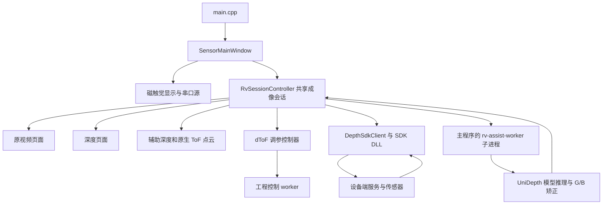

# 项目架构

`RvInferenceSettings` 管理启动候选检测、手动测速、设备选择和运行时回退。`RvInferenceRuntime` 管理硬件候选、固定模型身份、运行库指纹和原生 OpenVINO 会话。`RvAssistDepth` 承担预处理、G/B 矫正与独立 worker 生命周期。TensorRT ORT 与兼容 ORT／OpenVINO 在子进程中隔离。详见 [UniDepth 推理设备选择](MULTI_BACKEND_INFERENCE.md)。

本项目是独立的 Windows x64 传感器上位机，主窗口提供磁触觉、深度图、点云和摄像头原视频。dToF 运行预设由成像方案选择。本文描述当前日常版本的架构。当前保护实现及安装包约定见 [模型保护](MODEL_PROTECTION.md)，维护约束见工作区的 AGENTS.md（仅本地保存）。

## 产品边界

主窗口提供四个模块，以及设备管理、渲染、语言、停靠和布局预设。深度图默认使用 G，退役的成像选项也迁移至 G。

| 显示名称 | 产品入口 ID | 推理和处理位置 |
|---|---|---|
| 上位机辅助推理（G） | `host_unidepth_rgb672_vga_fp16_tof48_g` | 同帧竖幅单目深度与 48×32 ToF 全局尺度校正，每份测量只用一次 |
| 上位机辅助推理（B，复用 ToF） | `host_unidepth_rgb672_vga_fp16_tof48_b` | 同一套模型与尺度校正，允许复用最新合格测量 |
| 板端推理（1200K） | `board_native_tof48_1200k` | 48×32 普通原生 ToF，本次采集主积分 1200K |
| 板端推理高精度（1200K） | `board_native_tof48_high_accuracy_1200k` | 48×32 高精度原生 ToF，本次采集主积分 1200K |

两个主机方案共用 worker 模型 ID `unidepth_rgb672_vga_fp16_tof48`。可见产品入口声明见 `DCTS_APP.json`，入口过滤由 `DepthMapWidget`、`RvSessionController`、`RvAssistDepth` 和 `RuntimeDiscovery` 实现。共享协议中的历史常量用于识别旧诊断格式。

Depth Pro 2-S 使用 SDK 的 F6 Native48 与 2304×1296 H.265。方案 ID `host_depthpro2_s_vga_fp16` 对应 G，加 `_reuse_tof` 后缀的 ID 对应 B。RGB 准备线程只计算 672×504 校正表中 `(16,12,640,480)` 子网格。焦距约 385.185 px，主点为 (319.5, 239.5)。`DctsDepthPro2Worker.exe` 校验模型、图和引擎身份，并把 TensorRT 预测恢复到这个网格。主进程按请求保留原生 ToF，在验证返回的帧号和模型身份后，用同一网格的 F6 投影和 G/B 全局尺度校正生成深度、点云和快照。近场分区校正仍供 UniDepth G 使用。

移植来源 `E:/WORK/Dexterous Hand Visualization` 只读。当前工程的源码、模型包、RV worker、资源和配置均独立；日常运行不依赖该来源项目目录。

## 模块与进程



`SensorMainWindow` 创建一个共享 `RvSessionController`，深度页面、原视频页面和 dToF 调参模块围绕同一个设备会话工作。不能为每个页面各自启动一套采集服务。板端通过 SDK 使用 F6 的原生 ToF 采集、状态服务和 H.265 视频。单目模型、RGB 校正和融合留在主机。

| 入口或文件 | 职责 |
|---|---|
| `main.cpp` | 应用初始化、独立配置、离线测试分发、主机推理 worker 分发 |
| `SensorMainWindow.*` | 模块与菜单、布局恢复、异步停止和退出等待 |
| `TactileDockWidget.*`、`sensors/TactileVisualizationWidget.*` | 磁触觉操作、曲线、三维显示与串口连接 |
| `sensors/TactileSerialSource.*` | 串口测量、设备型号识别及有界自动置零 |
| `sensors/TactileSceneAdapter.*`、`TactileSurfaceModel.*`、`TactileCanvas.*` | 触觉场景、PLY 表面和 Qt Widgets 投影 |
| `sensors/DepthSdkClient.*`、`sensors/RvSessionSdk.cpp` | SDK 设备管理、RGB 和深度回调、同代次质量图及配对 |
| `sensors/RvSessionController.*` | 设备身份、成像状态机、配对、结果时效、共享采集和停止 |
| `sensors/RvHdVideoStream.h`、`RvCameraStream.h`、`RvDtofBoardStream.*` | 高清视频、RGB 处理及原生 dToF 接收 |
| `sensors/RvAssistDepth.*` | 原生模型会话、worker IPC、模型输入方向、预测逆恢复和融合调用 |
| `sensors/RvAssistFusion.*`、`RvDepthDiagnostic.*`、`RvDepthCoverage.*` | 米制融合、尺度连续性、校正点和同帧诊断 |
| `sensors/RvDepthView.*`、`DepthMapWidget.*`、`RtspCameraPage.*` | 深度与视频显示、悬停数值、显示设置和快照 |
| `sensors/RvPointCloudWidget.*`、`RvPointCloudCanvas.*` | 辅助深度和原生 ToF 反投影、点云显示和视角操作 |
| `sensors/RvDeviceStore.*`、`RvDeviceManagerDialog.*` | 受信任设备档案、固定默认标定和输入方向 |
| `sensors/RvTunerController.*`、`RvTunerWidget.*`、`RvTunerProtocol.*` | 独占调参、异步操作、停止、长期参数保存 |
| `RvControlWorker.cpp`、`RvControlProtocol.*` | 原生 libssh2/OpenSSL 控制、身份校验与板端服务操作 |
| `RuntimeDiscovery.*` | 应用根目录、运行时覆盖路径、worker 清单和依赖校验 |

点云与深度图共享成像会话。板端档订阅 `tofFrameReady`，通过 F6 GEO2 射线和相机平移得到原生测点的 XYZ。上位机辅助推理档订阅 `assistDepthSnapshotReady`，用 480×640 相机 Z 和对应内参逐像素反投影。后台一次转换一帧，转换期间保留最新待处理帧。Qt Widgets 视口用深度缓冲绘制彩色点与三角网格，上位机点径按屏幕像素设置，Z 色标使用点云自己的设置。两种数据源都使用 X 向右、Y 向上、前方为负 Z 的场景坐标。停采、切档或过期时清空数据并保留视角。

主机模型 worker 使用同一构建产出的 ASCII 文件名 `DctsInferenceWorker.exe`，以 `--rv-assist-worker` 启动 `QCoreApplication` 和二进制 IPC。`RuntimeDiscovery::NativeWorkerResult` 返回原生 `RvControlWorker.exe` 的路径和校验错误，`nativeWorkerEnvironment()` 限制设备控制进程的 DLL/Qt 环境；没有 Python 回退。

原生档位显示径向测量，保持原始索引和有效位。主机推理共用 RGB672 UniDepth 模型。工程调参保留其支持的网格、独占及保存流程。历史精简范围见 [第二轮精简记录](SOURCE_CLEANUP_PHASE2.md)。

普通启动由 `main.cpp` 显式请求一次磁触觉默认串口连接，待模块可见和触觉视口就绪后执行。控件构造、显示、离线专项及实机深度专项均不会自行打开磁触觉串口。默认参数优先恢复 `tactile/serial` 中上次经有效回包确认的端口、波特率、地址和模块。已保存端口缺失时保持待连接。自动、手动和重连均先以 0x03 读取 0x44C0，严格校验地址、功能码、长度、CRC 和型号值 1/2/3。优先使用当前地址，失败后在当前波特率尝试公共地址 0。公共地址恢复适用于单设备总线，需读出 0x466C 的实际地址并用该地址复读同一型号。未知型号或识别失败显示错误状态，不改变设置面板的显隐。界面按同次 session/generation 的已确认型号同步更新选中模块、硬件类型和实际地址，首帧使用实际型号的 20/16 点布局。手动修改通信参数后连接也走相同流程。

首份 CRC 正确、量程有效且身份匹配的数据到达后，停止连接响应计时并进入有界的自动 delta 置零。`TactileAutoZero` 在串口线程逐帧处理原生测量，先舍弃 150 ms 的稳定等待段，再检查最近 300 ms 的有效帧：至少 6 帧、跨度至少 200 ms、相邻有效帧间隙不超过 120 ms，每点每轴极差不超过 150 counts，前后半段均值差不超过 40 counts。最早 500 ms 完成稳定均值置零；900 ms 到期仍未形成稳定均值时，以本次连接最新一份 CRC 正确、量程有效且身份匹配的原生帧自动置零一次。兜底与正常均值置零使用同一个完成流程，不显示未完成或要求手动置零的提示。计时从首份有效测量开始；尚无有效测量、断开或显式取消不会生成零点。均值按原始单 count 精度取整并重算合力，只用作显示基线，不进入原始帧或采集历史。完成结果随最新帧持续携带，GUI 合并采样不会丢失零点。等待期间隐藏力箭头和曲线，自动置零完成后隐藏状态行并回收其布局空间，不显示完成提示、帧数或耗时，通信诊断开关也不会恢复该提示；均值置零和到期单帧置零均不改变设置面板的显隐，手动置零按钮继续可用。默认约 1.5 秒未收到首份有效数据则异步停止，较长通信超时会相应增加连接等待时间。每个连接会话只进行一次有界自动置零，完成后不跟随受力更新基线。运行中结合 Windows 串口到达与移除通知及端口列表轮询，检测到记住的端口新出现时，按当前界面上的波特率和从站 ID 尝试连接。没有记住的端口时，仅在单个串口新出现时尝试。热插拔快速探测窗口至少为 10 秒。失败后保留当前设置面板显隐，端口仍存在且被选中时，等待 3 秒后再执行一轮型号识别，当前地址和公共地址各尝试一次。识别成功且首帧有效后继续使用同一个串口采集，失败则在等待期间释放串口。端口缺失时只监测插拔。用户主动断开后，同一次插接保持停止。

“连接设置”每次启动默认展开，“显示设置”默认收起，之后只由用户手动显隐。两个面板不随连接、置零、故障、断开、重试或模块启停自动展开或收起；不保存展开状态，也不读取旧的 `tactile/display/expanded` 偏好。其余显示参数继续持久保存。

磁触觉请求后间隔默认及下限均为 10 ms，可在采集中修改。串口线程在一笔请求完整结束后用 Windows 高精度等待定时器计时，停止、配置操作和间隔编辑可唤醒等待；系统无法创建该定时器时退回有界睡眠。自动置零期间临时使用 10 ms 请求后间隔，成功、失败或取消后恢复当前用户请求间隔，界面数值和持久偏好不被临时采样覆盖。置零开始后单次响应等待受剩余 900 ms 窗口约束，避免较长通信超时拖住本次尝试。单次请求的传输和响应耗时另计，GUI 仍按独立的 33 ms 定时器读取最新数据。轻微读数抑制默认开启，用户保存的显示偏好继续生效；原始数组和串口协议不受显示置零或抑制影响。

磁触觉“显示方式”保留 gridSize 2/3/4 档，名称按当前模块的实际点数生成：F/G 为 20/65/136，S 为 16/49/100。首次启动选择最高点数档和流畅渲染，后续恢复用户选择。`TactileSurfaceModel` 的采样函数复用既有空间插值权重；列表对当前帧、零点基线采样，曲线对原始历史逐帧采样，不向 `Frame` 或 `TactileHistory` 填入伪造的原生测点。列表和曲线分别在 100 ms 和 66 ms 内合并刷新请求，三维发布和历史采样沿用原有节奏。点选、置零和密度切换即时刷新相关视图。选择超出较低密度范围时收敛到有效行。

列表仅输出从原始基线计算的 delta，轴表头为 X、Y、Z；基线或数据无效时显示“--”，不回退显示当前读数。共享 `zeroSmallComponents` 仅对 X、Y 应用原有的包容边界阈值，Z 原样通过；模型、曲线、列表及插值点均采用此策略。三维模型保持原有的基线相减及插值顺序。过滤仅影响显示，不改原始帧、串口诊断、跳变准入或历史样本。

通信状态每次启动时关闭，隐藏的状态行不占用空间。开启后，串口栏显示端口、ID、接收计数和通信错误，列表下方只在有可显示的过滤错误时出现提示。三维测点详情显示点号与数值。模拟数据源、模拟场景和底部恢复模拟/场景下拉/暂停按钮均已删除，硬件断开使用连接设置中的异步停止入口。窗口启停与可见性只控制显示刷新和串口挂起，不产生读数。无设备、断开、错误型号页面或数据失效时保留模型并显示“设备未连接/数据不可用”；其他型号不会补充模拟帧。固定原生格式样本仅存在于测试目录，用于离线渲染回归，不提供产品入口。

## 主机辅助推理数据链路

输入方向在「设置 → 设备管理 → 上位机推理输入朝向」调整。已有设备沿用旧版深度图按设备及安装角度保存的方向，设备管理显示该生效值。应用按受信任设备公钥指纹保存当前输入方向，SDK 管理连接档案。

RGB 的 ToF 配对在入队前确定，校正与 planar 张量转换由单个后台线程处理，只保留最新待处理帧和最新完成结果。停止和切换会废弃上一轮准备结果，排队时间计入时效预算。

深度视图把米制数组解码、有限值检查和显示视场扫描合并为一次遍历，继续校验模型身份、实际 FOV、有效像素数和预测侧区准入。着色仍在独立线程执行，并缓存现有色带全部 24,001 个色相状态的 Qt RGB 值，保留 [Qt 6.11.1 的 HSV 色相取整](https://github.com/qt/qtbase/blob/v6.11.1/src/gui/painting/qcolor.cpp#L2375)。离线测试逐一核对色相取整边界及颜色范围／无效值规则。该优化没有更换模型、精度、颜色映射或保存格式。

1. 原视频和原生 dToF 数据进入共享会话，携带设备身份、generation、frame、原生序号和时间戳等元数据。
2. RGB 使用对应标定图处理到模型输入网格。模型输入为 `[1,3,504,672]`、`uint8`；输出为 `[1,1,480,640]`、`float32` camera-Z 米制深度。
3. 根据设备档案中的实际模型输入方向，按 0°或 180°处理输入；180°输入按每个平面通道反转。
4. 模型结果先逆恢复到 640×480 标定网格，再从 `(140, 0)` 中心裁取 360×480 并等比例重采样至 480×640。配对 RGB 和视场内参同步调整。G 或 B 在该网格上使用 F6 48×32 原生测量进行全局尺度拟合。
5. worker 返回米制深度、同帧元数据及 `mono_reasons_v1` 诊断；会话检查身份、方向和时效后交给显示层。

G 选择与 RGB 捕获时间最接近的测量，每份测量最多更新一次尺度。B 选择时间最新的合格 ToF，复用时校验测量身份、时间戳和字节，并记录 `tof_reused`。时间差和时钟裕量之和上限为 200 ms，使用 35 ms 裕量时允许 165 ms 的捕获时间差。缺少合格测量时使用有效的历史尺度或单目预测。历史尺度帧不包含旧校正点。

从 2304×1296 解码帧直接校正取样 672×504。模型内部裁去左右各 16、上下各 12 像素得到 640×480。竖幅裁剪收窄水平视角以匹配 F6 ToF 视场。模型和输入映射各自绑定 SHA-256。

`RvAssistFusion::ScaleContinuity::apply` 使用实际单调时间计算平滑，因此不同运行节奏下的融合结果可能不同。逐字节检查使用固定身份、方向与历史状态的合成样本。

`RvDepthDiagnostic` 的 schema 2 保留原始预测、全局结果、最终深度、原因位、原生点、身份和文件哈希。回放支持当前 G/B 竖幅诊断及旧 H 诊断，按记录的尺度重建结果。F6 近场 48×32 射线的横向残差投影也随帧记录。二进制 IPC 使用原有 `mono_reasons_v1` 格式。

## SDK 采集与板端准入

设备枚举、USB 登记、选定设备、连接、停采、修复和双绿网格调用 SDK 2.2.2 的公开 C ABI。自动发现将 SDK 的 USB 检查 ID 传给连接请求，停止会撤销待执行的确认。成像共用一个 SDK 会话。

普通和高精度板端档请求 mode24 和 mode25。两档沿用 SDK 的 1200K 出厂默认值和原有的工程调参保留策略。原生深度通过扩展回调取得径向米制数据、SNR 和有效图，重建测量采集和点云需要的同帧距离码。SDK 将缺测径向距离置零。使用本项目已有的 F6 射线和 RGB 校正表进行点云投影与模型校正。

SDK 回调的 RGB 解码时间属于主机单调时钟。ToF 采集时间属于板端单调时钟。主机从 ToF 请求往返和板端帧龄估计 ToF 在主机时钟的区间，再选择同代次的合格测量。诊断保留 SDK 配对来源。这个时间窗口用于软件融合，RGB 曝光同步需要单独的实测依据。

## 显示和数值契约

原视频底栏的画面旋转联动原视频与深度图。两个原生 ToF 档位另有独立的“输入角度”按钮，默认额外顺时针 90°，允许 0–359°并保存；该角度不改变 UniDepth、模型输入、标定、原生数组或保存图像。`RvDepthView` 仅对启用原生角度的画布做任意角度适配与悬停逆变换。

深度图底栏默认使用「固定色标」，范围为 0.01–11 m，最小值须小于最大值，点击「应用」生效。「动态＋直方图均衡」复用点云的逐帧 Jet 着色算法，用于深度图预览。深度图和点云各自保存上色方式。保存的深度图使用固定色标和校正后的米制数据。

`RvDepthView::presentationImage()` 可以使用经过同帧验证的预测补充 dToF 几何视场外的显示。深度图的「仅显示单目深度」让深度图和点云同时选用同帧 `mono_reasons_v1` 中的未校正预测。`snapshotImage()`、`depthAt()`、浮点数组和普通保存使用校正后的米制数组和掩码。

原视频和深度的启停与重连调用同一个设备会话。自动启动要求受信任设备、原生采集程序和所选会话预设通过校验。USB 首次部署及修复校验同次启动身份、标定、驱动摘要、采集占用和原生采集能力，并保留原厂启动配置与回滚。工程调参控制器继续负责独占、异步停止和退出等待。

## 目录和资源

| 位置 | 内容及处理方式 |
|---|---|
| 根目录 `.sln`、`.vcxproj`、`.filters` | 主构建工程；不要改为以临时项目替代主工程 |
| `sensors/` | 数据源、会话、融合、显示和调参实现 |
| `assets/camera/` | 标定、几何、校正图及来源信息 |
| `assets/tactile/`、`models/tactile/` | 磁触觉布局与 PLY 表面 |
| `archives/cad/tactile/` | 三种触觉的 STEP 原件；由 `models/tactile/surface_layouts.json` 相对定位并记录 SHA256，不参与运行 |
| `archives/validation/` | 历史构建日志，以及 2026-11-08 验证历史 ZIP、逐文件 SHA256 清单和原路径索引；报告、历史安装包、备份与私有输入在归档中完整保留 |
| `SensorResources.qrc`、`Component_depth.qrc`、`Component_tactile.qrc` | 编译进程序的翻译、相机校正图和触觉表面 |
| `translations/` | TS 源和 lrelease 生成的 QM；QM 随资源编译 |
| `UniDepthRuntimeRgb672VgaFP16RTX/` | 日常明文模型、ORT/TensorRT-RTX DLL、模型身份与完整文件哈希清单、许可材料 |
| `config/` | 当前软件自己的设备档案和偏好，需要当前运行账户可写 |
| `tools/`、`tests/` | 构建、原生依赖准备、离线和实机验证入口 |
| `tools/rv_capture/` | Native16/Native48/SPI/H.265 纯采集源码、协议、部署资源和 F6 构建入口 |
| `x64/Release/`、`x64/Debug/` | 主程序及 Qt/FFmpeg 部署目录 |
| `x64/rv_control/<配置>/runtime/` | 原生设备控制 worker、SSH/加密依赖、调参载荷及 `implementation.json` |
| `x64/validation/` | 当前忽略的测试输出、归档阅读入口及保留的安装工具；2026-11-08 以前的历史材料见 `archives/README.md`，不代表当前验收状态 |

新增源码、头文件和资源时同步维护编译、MOC、RCC 和 filters。修改翻译必须运行 lrelease。

## 配置和运行时定位

`RuntimeDiscovery::applicationRoot()` 从 EXE 目录向上查找主工程文件或 `DCTS_APP.json`。安装包在 EXE 目录提供相对运行路径，不需要工程文件或产品声明文件。

EXE 旁的 `runtime-paths.json` 使用相对 EXE 目录的路径；同名环境变量优先。当前主要覆盖项为 `RV_CONTROL_CPP`、`RV_ASSIST_RGB672_VGA_FP16_ROOT`。日常默认指向本项目内部的 worker 和明文模型包，实验启动器只为自身进程覆盖模型根目录。

`main.cpp` 将设备库定向到 `config/devices.json`，安装版的 `config/` 位于 `%LOCALAPPDATA%/DepthCameraAndTactileSensor/`，开发版位于项目根目录。INI 偏好位于 `config/preferences/DepthCameraAndTactileSensor/`。普通首次启动从资源内的 `first-run-settings.ini` 补齐可移植默认值，初始化后沿用用户配置。旧注册表及旧 INI 的兼容导入由显式 `--import-settings` 入口执行。设备密码由 Windows 凭据管理器管理；拷贝设备 JSON 不会迁移密码，已有 SSH 身份校验也不等于模型许可证绑定。

## 构建和验证

构建环境为 VS 2022 v143、Windows SDK 10.0.22621.0、Qt 6.11.1 MSVC x64 和 QtMsBuild。根目录构建入口：

```powershell
./tools/build_desktop.ps1 -Configuration Release -QtRoot E:/Qt/6.11.1/msvc2022_64
./tools/build_desktop.ps1 -Configuration Debug -QtRoot E:/Qt/6.11.1/msvc2022_64
```

默认同时重建 RV worker，校验其依赖闭包，并部署 Qt Widgets、视频插件和 SDK 运行文件。保持 `NativeWorkersBuild=true`；主机应用构建通过不能替代 worker、模型清单和运行时依赖的验证。

离线入口为 `tools/run_offline_tests.py`，包含 UI、调参、触觉串口协议、触觉可视化、三维渲染、融合恢复及 USB 登记八组专项。`tools/verify_port.py` 验证 G/B 在 F6 下的 0°/180°、配对边界、原始模型输出及停止重启。命令与统计口径见 [测试与源码统计](TESTING.md)。

测试报告放入新的 `x64/validation/` 子目录，防止覆盖旧证据。GPU 合成推理属于离线验证，不连接相机或串口；真实设备验证由 `tools/run_live_validation.py` 单独执行，需要针对当前任务的明确授权。README 中的历史实机结果不代表设备当前状态或新改动的实机验收。

模型保护实验曾遇到沙箱内 QtMsBuild 注册表访问被拒和 VS PDB 服务错误，使用正常工具链权限后构建通过。此类错误应先按工具链访问问题核对，不据此修改模型、标定或传感器参数。

## 运行和客户环境

日常运行是原生 C++/Qt、ORT/TensorRT-RTX 与原生 RV 控制，不需要客户安装 Python、Conda、PyTorch、Visual Studio 或 Qt SDK。开发验证脚本使用 Python，部分需要 NumPy。

运行包需要 Qt DLL 和插件、CXWL Depth Camera SDK 和 FFmpeg、工程控制 worker 及模型运行时，以及匹配 v143 构建的 x64 VC++ 运行库。主机 FP16 模型需要兼容的 NVIDIA RTX GPU 和驱动。日常模型包携带 TensorRT-RTX 与所需的 CUDA 用户态运行库。板端需要配套原生采集服务和受信任档案。串口设备需要对应硬件驱动，配置目录需要可写。

安装包要求经认证的加密模型。构建入口、性能证据、原始权重保护和交付目录规则见 [模型保护与安装包约定](MODEL_PROTECTION.md)。


2026-11-09 移除 LiteSR 板端推理的范围及本轮验证见 [仅保留上位机辅助推理](HOST_ASSIST_ONLY.md)。
