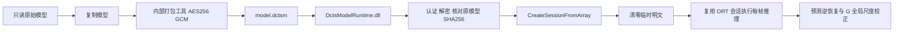

# 安装包构建与模型保护

## 当前安装包

`tools/installer/build.ps1` 使用 Release 主工程构建一份 `触想工作台.exe`。安装载荷包含 CXWL Depth Camera SDK 2.2.2、F6 原生采集与工程控制 worker、ADB、Qt 6.11.1、FFmpeg、VC++ x64 运行库、VLC 3 x64 的 RTSP/H.265 组件和对应许可。采集载荷按 `implementation.json` 和 `board-import.json` 校验文件及 SHA-256。

构建检查会拒绝暂存目录内的模型运行包、伴随推理程序、模型文件和编译中间产物。Depth Pro 2-S 研究运行包使用 `tools/depthpro2/build.ps1` 独立组装，模型许可随 `DepthPro2Runtime/` 保存。主机推理不可用时，首次实际选档为普通板端档，配置保留 `host_assisted_depth` 偏好。安装版用户配置位于 `%LOCALAPPDATA%/DepthCameraAndTactileSensor/config`。

在 PowerShell 7 中从项目根目录运行。需要 VS 2022 v143、Qt 6.11.1 MSVC x64 及对应 Qt 源码许可、ADB、官方 VLC 3 x64 解包目录、Inno Setup 和简体中文消息文件。SDK ZIP 可以通过 `DCTS_DEPTH_SDK_ZIP` 指定，主工程按固定摘要校验。ADB 默认取 `x64/Release/platform-tools`，可用 `-PlatformTools` 指定位置。构建目录使用 `x64/validation/` 下的新子目录。

```powershell
$work = Join-Path $PWD ('x64/validation/installer-' + (Get-Date -Format 'yyyyMMdd-HHmmss'))
$installerTools = Join-Path $PWD 'x64/validation/installer_tools'
$installerArgs = @{
    BuildDirectory = $work
    QtRoot = 'E:/Qt/6.11.1/msvc2022_64'
    VlcRoot = Join-Path $installerTools 'vlc-3024-verified/vlc-3.0.24'
    Iscc = Join-Path $installerTools 'InnoSetup/ISCC.exe'
    ChineseMessages = Join-Path $installerTools 'ChineseSimplified.isl'
    Version = '1.1.8'
}
.\tools\installer\build.ps1 @installerArgs
.\tools\installer\prepare-sandbox.ps1 -BuildDirectory $work
```

`-StageOnly` 只生成暂存载荷。使用 `-UseStagedPayload` 复用同一目录时，脚本重新核对成像方案、桌面 EXE 的 SHA-256 及板端采集清单。复用已含 VLC 的载荷时沿用暂存的 VLC 路径。安装程序 `触想工作台-内测版-v<版本>-x64.exe` 及其 `.sha256` 文件均生成在 `delivery/`。

打开 `DctsCleanInstall.wsb` 可在关闭网络和 vGPU 的 Windows Sandbox 中执行离线安装检查，报告写入 `sandbox-results/`。完整检查包含三档菜单、主机推理不可用时的板端默认选档、八组离线专项、原生 worker 自检、普通窗口启动和卸载。`-SmokeOnly` 使用较短的安装、启动、关闭及卸载检查。真实设备验证使用 [测试文档](TESTING.md#实机专项) 中的入口。

## 携带模型的历史交付与保护约定

用户于 2026-11-02 为携带模型的安装包确认了原生 DLL、AES-256-GCM 加密模型和 ORT 内存加载方案。保护目标为防止直接从安装目录复制得到可使用的明文模型。以下记录 UniDepth 的历史集成、验证与权属材料。

## 历史 UniDepth 集成状态

| 范围 | 当时实现 |
|---|---|
| 旧版日常构建 | 使用 TensorRT-RTX EP 加载本地明文模型 |
| 隔离实验 | DLL 解密、内存加载、完整 H worker、Release/Debug 和 UI 离线专项均已验证 |
| 旧版安装构建 | 在隔离目录生成密钥、密文和原生 DLL，再将受保护的 UniDepth 运行包编入中文安装器 |

历史保护工具源码保存在 `tools/model_protection/`，包括 `ModelProtectionApi.h`、`ProtectedModel.cpp`、`PackModelCopy.cpp` 和 `ModelProtection.vcxproj`。v1.1.5 的安装构建从 `UniDepthRuntimeRgb672VgaFP16RTX/` 的 640×480 模型副本生成新密钥、密文和 DLL，并核对原始文件的 SHA-256 和修改时间。下文保留更早的独立 CUDA 实验结果。

历史 UniDepth 模型按提供方的权属声明记录为 `LicenseRef-Proprietary`，对应材料为历史模型包的 `licenses/Proprietary-Model-NOTICE.txt`。本地 Depth Pro 2-S 的权属及当前软件依赖见 [许可记录](OPEN_SOURCE_LICENSES.md)。

## 历史兼容后端和 INT8

2026-11-09 新增 DirectML、通用 ORT CPU、OpenVINO CPU／Intel GPU 和可选混合 INT8，见 [推理设备选择](MULTI_BACKEND_INFERENCE.md)。原图仍使用现有 AES-256-GCM 密文；DirectML／CPU 复用 `DctsCreateProtectedSession`，OpenVINO 使用新增 `DctsCreateProtectedOpenVino`，在 DLL 内认证、解密、核对固定 SHA256 并从内存编译模型，返回编译句柄后清零临时明文。IR 权重由 OpenVINO 自有张量持有，不能引用已清零的临时解密区。

INT8 的 XML／BIN 使用 `DCTOVIR1` 容器封装，独立加密为 `UniDepthRuntimeCompatible/decoder-int8.dctsm`，配套独立生成的加载 DLL。兼容清单的 `int8.model_protection` 记录保护方案、ABI、密文、DLL 和明文摘要。该版安装载荷使用受保护模型，原 ONNX、实验 IR 及开发容器只读保留。下文早期 CUDA 实验使用未量化的原图。

## 原始权重和本地开发规则

原始权重只读保留，所有加密、格式转换和损坏测试必须从副本开始。加密工具生成新的密文文件，拒绝覆盖已有输出；不能原地加密、覆盖或删除原始权重。实验前后核对原始模型哈希，记录文件修改时间，解密结果还应与输入副本逐字节或按原始 SHA256 比对。

开发目录、本地实验和原始模型归档可以保留明文权重。只有用户明确指出某个目录或产物用于客户交付时，才检查该指定交付路径没有未加密模型。不能将开发目录存在明文视为失败，也不能据此扫描清理整个工作区。

当时的开发运行包是 `UniDepthRuntimeRgb672VgaFP16RTX/`。旧 RGB576 原始包已按用户清理范围移至项目外，保持外部原件及 SHA256 清单；下述早期对照属于历史。本地保护实验使用独立模型与源码副本，原始包 28 项文件的 SHA256 和修改时间在实验前后均保持一致。

## 历史加载设计



DLL 负责解密并创建 ORT 会话。采用 TensorRT-RTX 的 UniDepth 构建使用 ORT 1.31.1，早期 CUDA 实验使用 ORT 1.23.2。加载保留相应的 FP16 设置及预测逆恢复。会话创建后清零临时明文缓冲区，逐帧推理复用会话。

实验使用 Windows CNG `bcrypt.dll` 实现 AES-256-GCM 和 SHA256，无新增 Python/PyTorch 运行时依赖。模型密文比原始模型增加 96 字节封装头，头部包含版本、长度、随机 nonce、认证标签和原模型 SHA256。GCM 认证覆盖封装元数据及模型内容；解密后再与主机绑定的预期模型 SHA256 比对，防止合法格式但错误身份的模型进入会话。

`ModelProtectionApi.h` 定义 C ABI，核心导出为 `DctsCreateProtectedSession`。主机传入既有 ORT API、环境和 session options，因此 CUDA 与图优化参数保持一致。实验密钥随机生成后以片段编译进 DLL，私有构建输入保存在实验的 `private_build/`，不是运行时依赖。试验密钥不直接沿用到正式产品；正式集成时建立公司内部的密钥生成和保管流程。

## 清单和拒绝策略

原有 `model.json` 的模型身份、输入输出、精度、标定和转换绑定保持。受保护包在 `runtime.json` 中增加以下结构，文件 SHA256 表收录密文和加载 DLL：

```json
{
  "model_protection": {
    "scheme": "aes256-gcm-memory-v1",
    "loader_abi": 1,
    "ciphertext": "model.dctsm",
    "loader": "bin/DctsModelRuntime.dll",
    "plaintext_sha256": "与当前绑定模型一致的64位小写SHA256"
  }
}
```

实际清单必须填真实 SHA256，上例字符串只是字段说明。加密包的 `files` 表不再要求原始 ONNX 文件，而要求 `model.dctsm`、`bin/DctsModelRuntime.dll` 和原有 ORT/CUDA 等依赖。主机初始化、模型可用性检查和 worker 启动均识别同一约定；不能只改清单或仅向旧主程序旁拷贝 DLL。

密文缺失、截断、认证失败、依赖指纹错误、ABI 不符或解密后模型身份不符时，拒绝加载并报告错误。即使同目录还有明文模型，也不回退读取它。SHA256 文件表用于检查完整性；模型内容还受 AES-GCM 认证和预期模型身份校验约束。

## 已验证的本地实验

早期实验目录为 `x64/validation/model_crypto_trial_20261102/`，其中曾保存完整的上位机实验副本。随后 v1.1.5 至 v1.1.7 的 UniDepth 安装构建集成了受保护加载。

| 位置 | 内容 |
|---|---|
| `src/ProtectionCommon.h` | 密文格式、只读输入/新建输出、CNG 加解密和内存清零 |
| `src/pack_trial.cpp` | 只对副本打包，先在内存中逐字节回验，再写新密文与私有构建输入 |
| `src/ProtectedModel.cpp`、`src/ModelProtectionApi.h` | 原生 DLL 实现及 ABI |
| `src/ModelProtection.vcxproj`、`src/ModelProtection.vcxproj.filters` | Release/Debug DLL 和打包工具工程 |
| `src/patch_host.py`、`reports/host_trial.patch` | 实验主机的加载分支、模型可用性和加载计时改动 |
| `src/prepare_runtime.py` | 构造独立包和参考程序，准备验证入口 |
| `src/benchmark.py` | 通过实际原生 H worker 做交错 A/B 计时 |
| `src/check_rejections.py`、`src/summarize.py` | 损坏拒绝、覆盖保护、原始文件复核及汇总 |
| `encrypted_runtime/`、`encrypted_runtime_debug/` | 受保护模型、对应 DLL 和运行时闭包 |
| `START_ENCRYPTED_TRIAL.cmd` | 为实验进程设置模型根目录，启动实验上位机；不替换日常启动器 |

当前实验的原始模型为 69,228,193 字节，密文为 69,228,289 字节。原模型 SHA256：

```text
2912174428afd1b5b6ceb503b716d58166184529909cb28b9a83f1d60cf686ca
```

该哈希仅标识此次实验输入；未来合法替换模型时应依据新模型重新绑定和验证，不可沿用旧值。

## 性能结果

2026 年 11 月 2 日在 RTX 3080 Ti、驱动 610.88 上，使用 Release 原生 H worker 和完整 `mono_reasons_v1` 诊断传输，按明文/加密交错顺序运行 8 轮。每轮排除首帧、预热 80 帧，再测 300 帧；每种模式统计 1,200 帧，使用相同合成输入和冻结的 EXE/DLL/模型包。

| 指标 | 明文加载 | 加密加载 | 差值 |
|---|---:|---:|---:|
| 推理均值 | 9.512 ms | 9.582 ms | +0.070 ms，约 +0.74% |
| 推理中位数 | 9.435 ms | 9.444 ms | +0.009 ms |
| 推理 P95 | 10.475 ms | 10.961 ms | +0.486 ms |
| worker 处理均值，含 H 矫正 | 11.636 ms | 11.730 ms | +0.094 ms |
| 本机 IPC 往返均值 | 13.516 ms | 13.618 ms | +0.102 ms |
| 启动到模型可用均值，热文件缓存 | 2.135 s | 2.157 s | +23 ms |

一次解密均值为 9.735 ms；加载时的 SHA256 校验约 30.564 ms，临时明文清零约 5.767 ms。推理均值的成对差异范围约为 -1.18% 至 +1.91%，0.74% 是本次观测值，不能作为精确的固定加密开销。数据不代表真实相机 FPS、光学端到端延迟或其他客户显卡性能。

推理计时包含 RGB 方向处理、ORT Run 和输出逆恢复；worker 计时另含 H 处理；本机往返再包含 IPC。H 连续尺度平滑使用实际单调时间，长流计时比较原始预测张量的一致性，固定场景专项另行比较最终深度与完整诊断。不能要求不同运行节奏的连续平滑深度始终逐字节相同。

## 一致性和失败场景

Release/Debug 各通过 28 个合成场景，其中 19 份有效深度、单目预测和诊断结果与参考程序逐字节一致，覆盖 F1/F2、0°/180°、100 ms 复用边界、输入拒绝、停止重启和不同 RGB 未重放。两配置各通过 7 组离线专项、1,072 个检查。全部验证未连接相机或串口。

8 项失败检查覆盖密文篡改、标签篡改、头部摘要篡改、截断、密文缺失、清单哈希不符、错误模型身份，以及打包工具拒绝覆盖输入副本。拒绝加载测试在旁边存在明文副本时仍不回退。

历史明细的原文件名为 `reports/final_summary.json`、`reports/performance_full_diagnostic/summary.json`、`reports/parity_Release/summary.json`、`reports/parity_Debug/summary.json` 和 `reports/rejections.json`。这些文件原先在项目外的 `retired_host_assets/` 内，目前该位置不可用。上表保留了已记录的主要结果。
