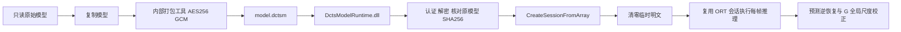

# 模型保护与安装包约定

当前开发版的上位机辅助推理使用 G。未来安装构建从主工程编译程序，收集 UniDepth 运行时和板端原生采集支持。I 方案封存在本地 `archives/`，该目录位于安装载荷之外。保护实现使用原生 DLL、AES-256-GCM 加密和 ORT 内存加载。

用户已于 2026 年 11 月 2 日确认：未来制作客户安装包时采用原生 DLL、AES-256-GCM 加密模型和 ORT 内存加载。目标是防止客户从安装目录直接复制得到可用的明文模型，模型随上位机提供使用。防蒸馏和强对抗内存提取不属于本次目标，设备授权、TPM 或云端服务也不是当前既定前提。

## 当前集成状态

| 范围 | 当前状态 |
|---|---|
| 根目录日常源码和 `START_RELEASE.cmd` | 使用 TensorRT-RTX EP 加载本地明文模型 |
| 隔离实验 | DLL 解密、内存加载、完整 H worker、Release/Debug 和 UI 离线专项均已验证 |
| 安装包构建 | 正式安装版要求受保护模型。构建工具在隔离目录生成新密钥、密文和原生 DLL，再编译中文安装器 |

当前维护入口为 `tools/model_protection/ModelProtectionApi.h`、`ProtectedModel.cpp`、`PackModelCopy.cpp`、`ModelProtection.vcxproj`，主机集成位于 `sensors/RvAssistDepth.cpp`，安装入口为 `tools/installer/build.ps1`。这些已在正常源码中；下文 2026-11-02 的独立 CUDA 实验用于历史追溯，不是当前源码入口。1.1.5 安装版改为携带 `UniDepthRuntimeRgb672VgaFP16RTX/` 的 640×480 加密模型；安装器构建从该运行包的明文副本生成新密钥、密文和 DLL，核对原文件 SHA256 和修改时间不变。开发版原文件继续保留。

当前模型按提供方对结构重设计和重新训练的权属声明记录为 `LicenseRef-Proprietary`，使用说明位于模型包的 `licenses/Proprietary-Model-NOTICE.txt`。现有名称、上游/转换字段和哈希用于技术追溯，不应因历史命名自行改写当前权属记录。实际第三方依赖材料保留，见 [许可记录](OPEN_SOURCE_LICENSES.md)。

## 兼容设备和 INT8 的安装版加载

2026-11-09 新增 DirectML、通用 ORT CPU、OpenVINO CPU／Intel GPU 和可选混合 INT8，见 [推理设备选择](MULTI_BACKEND_INFERENCE.md)。原图仍使用现有 AES-256-GCM 密文；DirectML／CPU 复用 `DctsCreateProtectedSession`，OpenVINO 使用新增 `DctsCreateProtectedOpenVino`，在 DLL 内认证、解密、核对固定 SHA256 并从内存编译模型，返回编译句柄后清零临时明文。IR 权重由 OpenVINO 自有张量持有，不能引用已清零的临时解密区。

INT8 的 XML／BIN 使用 `DCTOVIR1` 容器封装，独立加密为 `UniDepthRuntimeCompatible/decoder-int8.dctsm`，配套独立生成的加载 DLL。兼容清单的 `int8.model_protection` 记录同一保护方案、ABI、密文、DLL 和明文摘要。安装版强制保护，交付目录排除 `.onnx`、`.ovm` 及明文 IR，不发生明文兜底。原 ONNX、实验 IR 及开发容器只读保留。本节扩展当前加载方案；下文早期 CUDA 实验及“不量化”描述仅适用于当时的原图对照。

## 原始权重和本地开发规则

原始权重只读保留，所有加密、格式转换和损坏测试必须从副本开始。加密工具生成新的密文文件，拒绝覆盖已有输出；不能原地加密、覆盖或删除原始权重。实验前后核对原始模型哈希，记录文件修改时间，解密结果还应与输入副本逐字节或按原始 SHA256 比对。

开发目录、本地实验和原始模型归档可以保留明文权重。只有用户明确指出某个目录或产物用于客户交付时，才检查该指定交付路径没有未加密模型。不能将开发目录存在明文视为失败，也不能据此扫描清理整个工作区。

当前开发运行包是 `UniDepthRuntimeRgb672VgaFP16RTX/`。旧 RGB576 原始包已按用户清理范围移至项目外，保持外部原件及 SHA256 清单；下述早期对照属于历史。本地保护实验使用独立模型与源码副本，原始包 28 项文件的 SHA256 和修改时间在实验前后均保持一致。

## 加载设计



DLL 负责解密和会话创建，返回 ORT 会话，不向调用者提供明文模型缓冲区。当前默认开发版和安装版使用 ORT 1.31.1 TensorRT-RTX；历史 CUDA 构建使用 ORT 1.23.2。DLL 接收主机创建的 session options，保留相应 FP16 设置及预测逆恢复，不更换网络、不量化、不更改模型输入方向或输出网格。临时明文在会话创建完成后清零，不保存临时 ONNX，也不每帧解密或重复创建会话。

实验使用 Windows CNG `bcrypt.dll` 实现 AES-256-GCM 和 SHA256，无新增 Python/PyTorch 运行时依赖。模型密文比原始模型增加 96 字节封装头，头部包含版本、长度、随机 nonce、认证标签和原模型 SHA256。GCM 认证覆盖封装元数据及模型内容；解密后再与主机绑定的预期模型 SHA256 比对，防止合法格式但错误身份的模型进入会话。

`ModelProtectionApi.h` 定义 C ABI，核心导出为 `DctsCreateProtectedSession`。主机传入既有 ORT API、环境和 session options，因此 CUDA 与图优化参数保持一致。实验密钥随机生成后以片段编译进 DLL，私有构建输入保存在实验的 `private_build/`，不是运行时依赖。试验密钥不直接沿用到正式产品；正式集成时建立公司内部的密钥生成和保管流程。

## 清单和拒绝策略

原有 `model.json` 的模型身份、输入输出、精度、标定和转换绑定保持。受保护包在 `runtime.json` 中增加以下结构，文件 SHA256 表收录密文和加载 DLL：

```json
{
  "model_protection": {
    "scheme": "aes256-gcm-memory-v1",
    "loader_abi": 1,
    "ciphertext": "model.dctsm",
    "loader": "bin/DctsModelRuntime.dll",
    "plaintext_sha256": "与当前绑定模型一致的64位小写SHA256"
  }
}
```

实际清单必须填真实 SHA256，上例字符串只是字段说明。加密包的 `files` 表不再要求原始 ONNX 文件，而要求 `model.dctsm`、`bin/DctsModelRuntime.dll` 和原有 ORT/CUDA 等依赖。主机初始化、模型可用性检查和 worker 启动均识别同一约定；不能只改清单或仅向旧主程序旁拷贝 DLL。

密文缺失、截断、认证失败、依赖指纹错误、ABI 不符或解密后模型身份不符时，拒绝加载并报告错误。即使同目录还有明文模型，也不回退读取它。SHA256 文件表用于检查完整性；模型内容还受 AES-GCM 认证和预期模型身份校验约束。

## 已验证的本地实验

早期实验目录为 `x64/validation/model_crypto_trial_20261102/`，包含当时的完整上位机副本。该次实验没有替换当时的日常 EXE；后续正常源码和安装构建已集成保护加载，维护入口见本文开头。

| 位置 | 内容 |
|---|---|
| `src/ProtectionCommon.h` | 密文格式、只读输入/新建输出、CNG 加解密和内存清零 |
| `src/pack_trial.cpp` | 只对副本打包，先在内存中逐字节回验，再写新密文与私有构建输入 |
| `src/ProtectedModel.cpp`、`src/ModelProtectionApi.h` | 原生 DLL 实现及 ABI |
| `src/ModelProtection.vcxproj`、`src/ModelProtection.vcxproj.filters` | Release/Debug DLL 和打包工具工程 |
| `src/patch_host.py`、`reports/host_trial.patch` | 实验主机的加载分支、模型可用性和加载计时改动 |
| `src/prepare_runtime.py` | 构造独立包和参考程序，准备验证入口 |
| `src/benchmark.py` | 通过实际原生 H worker 做交错 A/B 计时 |
| `src/check_rejections.py`、`src/summarize.py` | 损坏拒绝、覆盖保护、原始文件复核及汇总 |
| `encrypted_runtime/`、`encrypted_runtime_debug/` | 受保护模型、对应 DLL 和运行时闭包 |
| `START_ENCRYPTED_TRIAL.cmd` | 为实验进程设置模型根目录，启动实验上位机；不替换日常启动器 |

当前实验的原始模型为 69,228,193 字节，密文为 69,228,289 字节。原模型 SHA256：

```text
2912174428afd1b5b6ceb503b716d58166184529909cb28b9a83f1d60cf686ca
```

该哈希仅标识此次实验输入；未来合法替换模型时应依据新模型重新绑定和验证，不可沿用旧值。

## 性能结果

2026 年 11 月 2 日在 RTX 3080 Ti、驱动 610.88 上，使用 Release 原生 H worker 和完整 `mono_reasons_v1` 诊断传输，按明文/加密交错顺序运行 8 轮。每轮排除首帧、预热 80 帧，再测 300 帧；每种模式统计 1,200 帧，使用相同合成输入和冻结的 EXE/DLL/模型包。

| 指标 | 明文加载 | 加密加载 | 差值 |
|---|---:|---:|---:|
| 推理均值 | 9.512 ms | 9.582 ms | +0.070 ms，约 +0.74% |
| 推理中位数 | 9.435 ms | 9.444 ms | +0.009 ms |
| 推理 P95 | 10.475 ms | 10.961 ms | +0.486 ms |
| worker 处理均值，含 H 矫正 | 11.636 ms | 11.730 ms | +0.094 ms |
| 本机 IPC 往返均值 | 13.516 ms | 13.618 ms | +0.102 ms |
| 启动到模型可用均值，热文件缓存 | 2.135 s | 2.157 s | +23 ms |

一次解密均值为 9.735 ms；加载时的 SHA256 校验约 30.564 ms，临时明文清零约 5.767 ms。推理均值的成对差异范围约为 -1.18% 至 +1.91%，0.74% 是本次观测值，不能作为精确的固定加密开销。数据不代表真实相机 FPS、光学端到端延迟或其他客户显卡性能。

推理计时包含 RGB 方向处理、ORT Run 和输出逆恢复；worker 计时另含 H 处理；本机往返再包含 IPC。H 连续尺度平滑使用实际单调时间，长流计时比较原始预测张量的一致性，固定场景专项另行比较最终深度与完整诊断。不能要求不同运行节奏的连续平滑深度始终逐字节相同。

## 一致性和失败场景

Release/Debug 各通过 28 个合成场景，其中 19 份有效深度、单目预测和诊断结果与参考程序逐字节一致，覆盖 F1/F2、0°/180°、100 ms 复用边界、输入拒绝、停止重启和不同 RGB 未重放。两配置各通过 7 组离线专项、1,072 个检查。全部验证未连接相机或串口。

8 项失败检查覆盖密文篡改、标签篡改、头部摘要篡改、截断、密文缺失、清单哈希不符、错误模型身份，以及打包工具拒绝覆盖输入副本。拒绝加载测试在旁边存在明文副本时仍不回退。

本次证据可从 [完整汇总](../../dToF/output/litesr_depth_only_20261106_v1/retired_host_assets/x64/validation/model_crypto_trial_20261102/reports/final_summary.json)、[性能明细](../../dToF/output/litesr_depth_only_20261106_v1/retired_host_assets/x64/validation/model_crypto_trial_20261102/reports/performance_full_diagnostic/summary.json)、[Release 一致性](../../dToF/output/litesr_depth_only_20261106_v1/retired_host_assets/x64/validation/model_crypto_trial_20261102/reports/parity_Release/summary.json)、[Debug 一致性](../../dToF/output/litesr_depth_only_20261106_v1/retired_host_assets/x64/validation/model_crypto_trial_20261102/reports/parity_Debug/summary.json) 和 [拒绝测试](../../dToF/output/litesr_depth_only_20261106_v1/retired_host_assets/x64/validation/model_crypto_trial_20261102/reports/rejections.json) 读取。实验位于忽略的目录，清理或迁机后这些链接可能缺失；本文件保留方案、状态和关键结果，缺失的本地报告不能当作新一轮验收证据。

## RV1103 原生采集和 LiteSR

`tools/rv_capture/` 提供 Native48/Native16 测量、H.265 进度及会话预设。LiteSR mode13 使用私有 F6 程序，先认证 AES-256-GCM 密文和原模型 SHA256，再在内存中初始化 RKNN 并清零临时明文。导入阶段认证密文和 F6 版本，运行阶段初始化 NPU。纯采集程序使用独立构建。文件和导入入口见 [板端源码与构建](../tools/rv_capture/README.md)。

## 安装包构建

在 PowerShell 7 中执行，使用 VS 2022 v143、Qt 6.11.1 MSVC x64、匹配的 Qt 源码/许可材料及 Inno Setup 6.7.3。默认读取已部署到 `x64/Release/platform-tools` 的 ADB，也可通过 `-PlatformTools` 指定来源。通过 `-VlcRoot` 指定已校验的 VideoLAN VLC 3 x64 解压目录，托管 H.265 使用其中的 libVLC 和插件。构建目录使用 `x64/validation/` 下的新子目录。

```powershell
./tools/installer/build.ps1 -BuildDirectory (Join-Path $PWD 'x64/validation/installer_release') -QtRoot E:/Qt/6.11.1/msvc2022_64 -VlcRoot C:/path/to/vlc-3.0.24 -TensorRtRuntime ./UniDepthRuntimeRgb672VgaFP16RTX -CompatibleRuntime ./UniDepthRuntimeCompatible -Version 1.1.7 -Iscc 'C:/path/to/ISCC.exe' -ChineseMessages 'C:/path/to/Languages/ChineseSimplified.isl'
./tools/installer/prepare-sandbox.ps1 -BuildDirectory (Join-Path $PWD 'x64/validation/installer_release')
```

复用已暂存载荷时，构建脚本校验成像菜单及两个桌面程序的 SHA256。旧载荷需从当前源码重新暂存。

安装程序命名为 `触想工作台-内测版-v<版本>-x64.exe`，并与 SHA256 校验文件一同保存在构建目录的 `delivery/`。只从该目录选取交付文件。`private_build/` 是内部构建目录，包含明文副本、当次生成的密钥材料和中间产物。安装版固定要求保护清单，安装后的用户配置位于 `%LOCALAPPDATA%/DepthCameraAndTactileSensor/config`。普通开发版继续读本项目独立配置和明文模型包。

安装目录和主程序名可包含中文。上位机推理通过随包的 `DctsInferenceWorker.exe` 启动，优先使用可读的 ASCII 路径或目录别名。别名不可用时，将所需 DLL、程序和加密模型运行文件复制到当前用户的私有 ASCII 临时目录。推理进程退出后清理临时文件和别名。

安装版和默认开发版均使用 ORT 1.31.1 和 TensorRT-RTX EP。安装版自带用户态推理 DLL，主机需要受支持的 Ampere 或更新的 NVIDIA RTX 显卡和兼容 CUDA 12.9 的驱动。显卡、驱动或模型不可用时，上位机显示原因，提示修复上位机运行文件及显卡环境。

打开生成的 `DctsCleanInstall.wsb` 执行离线 Windows Sandbox 验证，结果写入 `sandbox-results/`。TensorRT-RTX 加密加载及上位机深度输出需另在配备兼容 NVIDIA 驱动的主机验证。串口驱动、NVIDIA 驱动和板端服务按实际设备配置。对外分发前核对 Qt Quick 3D、TensorRT-RTX、CUDA 等第三方依赖的授权覆盖。
